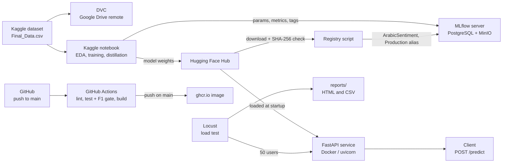
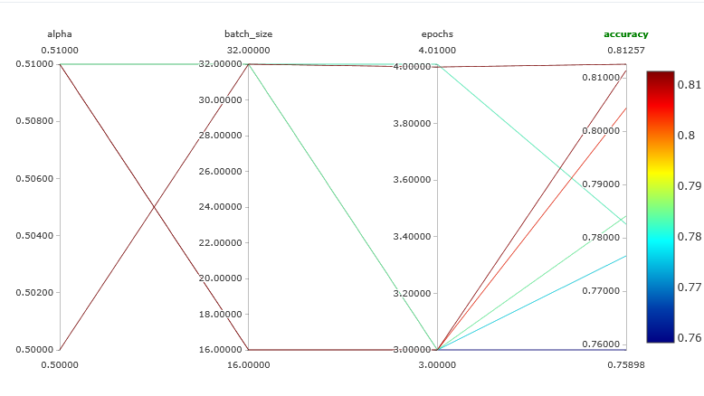

# Arabic Sentiment Analysis MLOps

An end-to-end MLOps pipeline for classifying Arabic customer reviews as **negative**, **neutral** or **positive**. It fine-tunes AraBERT v2, tracks every experiment in MLflow, publishes models to the Hugging Face Hub, registers the best one in a model registry, versions the data with DVC, checks every change with CI, and serves the model through a containerized FastAPI service that is load tested with Locust.

## Table of Contents

* [Overview](#overview)
* [Features](#features)
* [Results at a Glance](#results-at-a-glance)
* [Tech Stack](#tech-stack)
* [Project Architecture](#project-architecture)
* [Dataset](#dataset)
* [Installation and Usage](#installation-and-usage)
* [Phase 1: Project Setup and Packaging](#phase-1-project-setup-and-packaging)
* [Phase 2: Data Preparation and EDA](#phase-2-data-preparation-and-eda)
* [Phase 3: Modeling Baseline](#phase-3-modeling-baseline)
* [Phase 4: Inference API](#phase-4-inference-api)
* [Phase 5: Containerization](#phase-5-containerization)
* [Phase 6: Experiment Tracking with MLflow](#phase-6-experiment-tracking-with-mlflow)
* [Phase 7: Model Registry and Hosting](#phase-7-model-registry-and-hosting)
* [Phase 8: Compression by Knowledge Distillation](#phase-8-compression-by-knowledge-distillation)
* [Phase 9: Data Versioning with DVC](#phase-9-data-versioning-with-dvc)
* [Phase 10: CI/CD with GitHub Actions](#phase-10-cicd-with-github-actions)
* [Phase 11: Load Testing the FastAPI Baseline](#phase-11-load-testing-the-fastapi-baseline)
* [Roadmap](#roadmap)
* [Known Issues](#known-issues)
* [Completion Checklists](#completion-checklists)
* [License](#license)
* [Author](#author)

## Overview

Customer reviews are noisy, written in Modern Standard Arabic and in regional dialects, and heavily imbalanced: neutral reviews are only about 5% of the data. This project treats the problem as an MLOps exercise, not only a modeling one. The goal is a model that is reproducible, tracked, versioned, served behind a tested API and, in the next phases, compressed, monitored and rolled out safely.

## Features

* Fine-tuned **AraBERT v2** classifier with a class-weighted loss for the imbalanced data
* **FastAPI** service with input validation, a health endpoint and a model loaded once at startup
* Multi-stage **Docker** image and a `docker compose` stack (API, MLflow, PostgreSQL, MinIO)
* **MLflow** experiment tracking with data fingerprints (MD5) logged on every run
* Models published to the **Hugging Face Hub** with SHA-256 checksums
* **Model registry**: `ArabicSentiment` with a `Production` alias
* **Knowledge distillation** to a 6-layer student model
* **DVC** data versioning with a Google Drive remote
* **GitHub Actions** CI: lint, tests with an F1 quality gate, Docker build and push
* **Locust** load test of the FastAPI baseline, saved as an HTML report and CSV files
* Linting (ruff) and pre-commit hooks, with unit tests that do not need the real model

## Results at a Glance

Model quality, on the validation set (7,763 reviews, 20% stratified split, `random_state=42`).

| Model | Accuracy | F1 macro | F1 neutral |
|---|---|---|---|
| Baseline (published model, `lr 2e-5`, `batch 32`) | 0.7826 | 0.6537 | 0.2854 |
| **Best teacher** (`lr 3e-5`, `batch 16`) | **0.8114** | **0.6627** | 0.2806 |
| Student (6 layers, distilled) | 0.8126 | 0.6556 | 0.2614 |

Serving baseline (FastAPI, PyTorch FP32, CPU, 50 concurrent users, 2 minutes).

| Endpoint | Requests | Failures | p50 | p95 | p99 | Throughput |
|---|---|---|---|---|---|---|
| `POST /predict` | 602 | 0 | 7,500 ms | 14,000 ms | 20,000 ms | 4.95 req/s |

Details are in [Phase 6](#phase-6-experiment-tracking-with-mlflow), [Phase 8](#phase-8-compression-by-knowledge-distillation) and [Phase 11](#phase-11-load-testing-the-fastapi-baseline).

## Tech Stack

| Area | Tools |
|---|---|
| Modeling | PyTorch, Hugging Face Transformers, AraBERT v2 (`aubmindlab/bert-base-arabertv2`), scikit-learn |
| Training | Kaggle notebooks (GPU) |
| Serving | FastAPI, Pydantic, uvicorn |
| Packaging | uv, setuptools (`src/` layout), ruff, pre-commit, pytest |
| Containers | Docker (multi-stage), Docker Compose |
| Experiment tracking | MLflow 3.10.1, PostgreSQL 16, a MinIO-compatible S3 artifact store |
| Model hosting | Hugging Face Hub |
| Data versioning | DVC with a Google Drive remote |
| CI/CD | GitHub Actions, GitHub Container Registry (`ghcr.io`) |
| Load testing | Locust |
| Tunnel (Kaggle to local MLflow) | ngrok |

## Project Architecture



Project layout:

```
Sentiment-Analysis-MLOps/
├── .github/workflows/
│   └── ci.yml                   # lint -> test (+ F1 gate) -> docker build/push
├── .dvc/                        # DVC config (secrets live in config.local, ignored by git)
├── .dvcignore
├── data/
│   ├── Final_Data.csv.dvc       # DVC pointer; the data itself is on the remote
│   └── .gitignore
├── src/arabic_sentiment/
│   ├── api.py                   # FastAPI app (lifespan loads the model once)
│   ├── config.py                # Settings read from environment / .env
│   ├── data.py                  # loading and cleaning
│   ├── labels.py                # LABEL2ID / ID2LABEL
│   ├── model.py                 # AraBERT wrapper with type hints
│   ├── schemas.py               # Pydantic request / response models
│   └── train.py
├── tests/
│   ├── conftest.py
│   └── test_api.py              # API tests with a fake model
├── scripts/
│   ├── register_model.py        # log + register the best teacher in MLflow
│   ├── finish_registration.py   # tags + Production alias for an existing version
│   └── check_f1_gate.py         # CI quality gate
├── metrics/
│   ├── metrics.json             # recorded F1 of the current best model
│   └── baseline.json            # F1 threshold used by the gate
├── locust/
│   ├── locustfile.py            # load test definition
│   └── samples.txt              # 200 real reviews sampled from the dataset
├── reports/
│   ├── mlflow_comparison.png
│   ├── f1.png
│   ├── locust_fastapi.html      # Locust report (50 users)
│   ├── locust_fastapi_stats.csv
│   └── locust_fastapi_stats_history.csv
├── docker/mlflow/Dockerfile     # MLflow server image
├── notebooks/
│   └── eda_arabert.ipynb
├── Dockerfile
├── docker-compose.yml
├── pyproject.toml
├── uv.lock
├── .pre-commit-config.yaml
├── .env.example
├── .dockerignore
├── .gitignore
├── LICENSE
└── README.md
```

## Dataset

| | |
|---|---|
| Source | [Arabic customer reviews on Kaggle](https://www.kaggle.com/datasets/mohamedramadan2040/arabic-customer-reviews) |
| File | `Final_Data.csv` |
| Text column | `review_description` |
| Label column | `rating` (`negative`, `neutral`, `positive`) |
| Other column | `company` (used in EDA only) |

After cleaning there are 38,814 reviews: 31,051 for training and 7,763 for validation. Class balance on the validation set: negative 2,778 (36%), neutral 375 (5%), positive 4,610 (59%). The neutral class is the hardest one, which is why training uses a class-weighted loss.

## Installation and Usage

### Quick start (API only)

```bash
docker compose up --build api
curl -s -X POST localhost:8000/predict -H "Content-Type: application/json" -d '{"text": "الخدمة ممتازة"}'
uv run pytest
```

The first start downloads the model from the Hugging Face Hub and caches it in a Docker volume. Other useful calls: `curl -s localhost:8000/health`.

Response fields of `POST /predict`:

| Field | Description |
|---|---|
| `label` | `negative`, `neutral` or `positive` |
| `confidence` | Probability of the predicted class (0 to 1) |
| `model_version` | Version tag of the served model |

An empty `text` returns `422`.

### Full stack (API, MLflow, PostgreSQL, MinIO)

```bash
cp .env.example .env      # then set your own passwords
docker compose up --build
```

| Service | URL |
|---|---|
| API | http://localhost:8000 |
| MLflow UI | http://localhost:5000 |
| MinIO console | http://localhost:9001 |

The `.env` file holds passwords and is ignored by git; only `.env.example` is committed.

### Local development

```bash
uv sync
uv run pytest
```

The tests use a fake model, so they do not download any weights.

## Phase 1: Project Setup and Packaging

* `src/` layout with `pyproject.toml` (setuptools); `pip install -e .` works
* Dependencies managed with **uv**
* **ruff** with the `T20` rule (no `print()` in `src/`, logging only) and local **pre-commit** hooks
* Settings are loaded with Pydantic from environment variables and `.env`
* The AraBERT model is wrapped in a typed class, and the label mapping lives in one place (`negative=0`, `neutral=1`, `positive=2`)

## Phase 2: Data Preparation and EDA

Cleaning steps, in order:

1. Drop rows with a missing review or rating
2. Remove URLs
3. Remove Arabic diacritics (tashkeel) and tatweel
4. Drop empty and duplicate reviews
5. Map labels to ids

The EDA is in `notebooks/eda_arabert.ipynb` and covers four views: class distribution, review length per class, the most frequent companies, and the label mix for the top five companies.

## Phase 3: Modeling Baseline

AraBERT v2 fine-tuned on an 80/20 stratified split with a weighted cross-entropy loss.

| Setting | Value |
|---|---|
| Base model | `aubmindlab/bert-base-arabertv2` |
| Max length | 128 |
| Epochs | 3 |
| Learning rate / batch size | 2e-5 / 32 |
| Loss | Cross-entropy with balanced class weights |

Baseline results: accuracy **0.7826**, F1 macro **0.6537**, F1 weighted **0.8160**. The neutral class is the weakest (F1 about 0.29) because it has few examples. The model is published as [`DoaaMoh/arabert-sentiment`](https://huggingface.co/DoaaMoh/arabert-sentiment) and is the model the API is configured to load (version tag `v0.2.0`).

## Phase 4: Inference API

| Endpoint | Description |
|---|---|
| `GET /health` | Returns `{"status": "healthy"}`; used by the Docker healthcheck |
| `POST /predict` | Takes `{"text": "..."}` and returns `{label, confidence, model_version}` |

* Pydantic rejects empty text with `422`
* The model is loaded once in the FastAPI lifespan, not per request
* `predict` is a plain `def`, so FastAPI runs it in a thread pool; each request is one forward pass (no batching)
* Tests use a fake model, so they run without downloading weights (3 tests passing)

## Phase 5: Containerization

* **Multi-stage Dockerfile**: the builder stage installs dependencies with `uv sync --frozen --no-dev` into a virtual environment, and the runtime stage copies only that environment
* The model name and version are set with environment variables (`SENTIMENT_MODEL_NAME`, `SENTIMENT_MODEL_VERSION`); without them the code falls back to `aubmindlab/bert-base-arabertv2` and `v0.1.0`
* `docker compose` runs the API on port 8000 with a volume that caches the Hugging Face download
* The Docker healthcheck calls `/health`

## Phase 6: Experiment Tracking with MLflow

### Tracking stack

`docker compose` also starts the tracking stack:

| Service | Role |
|---|---|
| PostgreSQL 16 | MLflow backend store |
| MinIO-compatible store | S3 artifact store (bucket `mlflow`) |
| MLflow 3.10.1 | Tracking server and model registry (UI on port 5000) |

### Training on Kaggle

1. Start the stack with `docker compose up -d postgres minio mlflow`
2. Expose MLflow with `ngrok http 5000 --host-header=rewrite`
3. Save the ngrok URL as the Kaggle secret `MLFLOW_TRACKING_URI`
4. Run the training notebook on Kaggle; each run logs its parameters, metrics and data fingerprints

> **Note:** the Kaggle training notebook (baseline, five teacher runs and the distilled student) is not included in this repository. The original notebook that first trained the published baseline model no longer exists; the baseline numbers in this README come from re-evaluating the published model `DoaaMoh/arabert-sentiment` in the latest notebook.

Each run logs `model_name`, `lr`, `batch_size`, `epochs`, `seed`, the split settings, the metrics `accuracy`, `f1_macro` and `f1_neutral`, and MD5 fingerprints of the raw file, the train split and the validation split.

### Results

Five teacher runs with the same split and seed, plus a `baseline` run that evaluates the already-published model for reference.

| Run | lr | Batch size | Accuracy | F1 macro | F1 neutral |
|---|---|---|---|---|---|
| `lr3e-05_bs16` (best) | 3e-5 | 16 | 0.8114 | **0.6627** | 0.2806 |
| `lr2e-05_bs16` | 2e-5 | 16 | 0.8043 | 0.6567 | 0.2697 |
| `lr3e-05_bs32` | 3e-5 | 32 | 0.7841 | 0.6511 | 0.2737 |
| `lr2e-05_bs32` | 2e-5 | 32 | 0.7766 | 0.6471 | 0.2698 |
| `lr1e-05_bs32` | 1e-5 | 32 | 0.7590 | 0.6333 | 0.2597 |
| `baseline` (evaluation only) | 2e-5 | 32 | 0.7826 | 0.6537 | 0.2854 |



Observations:

* A higher learning rate and a smaller batch size gave the best results; the best run sits at the edge of the grid, so it was not fully explored
* The differences between runs are small and come from a single seed, so they should be read as a trend, not as proof
* The neutral F1 stays around 0.26 to 0.29 in every run; the gains come from the other two classes
* The best run was selected on the same validation set it is reported on, so the numbers are slightly optimistic

Best teacher, per class:

| Class | Precision | Recall | F1 | Support |
|---|---|---|---|---|
| negative | 0.85 | 0.81 | 0.83 | 2,778 |
| neutral | 0.20 | 0.48 | 0.28 | 375 |
| positive | 0.92 | 0.84 | 0.88 | 4,610 |
| macro avg | 0.66 | 0.71 | 0.66 | 7,763 |
| weighted avg | 0.86 | 0.81 | 0.83 | 7,763 |

## Phase 7: Model Registry and Hosting

### Hugging Face Hub

| Model | Repository | `model.safetensors` SHA-256 |
|---|---|---|
| Teacher (best run) | [`DoaaMoh/arabert-sentiment-v2`](https://huggingface.co/DoaaMoh/arabert-sentiment-v2) | `bd184466583c47f18a30985f8fdf32f520bdb87da4eafb21249c3904b8fd3157` |
| Student (6 layers) | [`DoaaMoh/arabert-sentiment-student`](https://huggingface.co/DoaaMoh/arabert-sentiment-student) | `0f328703bc04e9597de6f6230aded01244e2fbc362d9cc0506e9181f48bc4d32` |

Model files are larger than GitHub's 100 MB limit, so the repository stores the Hub link and the checksum instead of the weights.

### MLflow Model Registry

The best teacher is registered as **`ArabicSentiment`** and carries the alias **`Production`**.

```bash
uv run python scripts/register_model.py
```

The script:

1. Finds the best teacher run (highest `f1_macro`)
2. Downloads the model from the Hub and verifies its SHA-256
3. Logs it as an MLflow model under that run and registers it
4. Tags the version (`hf_repo`, `hf_commit`, `weights_sha256`, `source_run`) and moves the `Production` alias to it

MLflow 3 replaced the old registry stages with aliases, so "promoted to Production" means the `Production` alias points to this version. The API is still configured to load the earlier published model (`DoaaMoh/arabert-sentiment`); switching it to the registry's `Production` version is a later step.

## Phase 8: Compression by Knowledge Distillation

A 6-layer **student** is initialized from every second layer of the best teacher and trained with a combined loss:

```
loss = alpha * CE_weighted(student, labels) + (1 - alpha) * T^2 * KL(teacher_soft || student_soft)
```

| Setting | Value |
|---|---|
| Student layers | 6 (copied from teacher layers 0, 2, 4, 6, 8, 10) |
| Alpha / temperature | 0.5 / 2.0 |
| Learning rate / batch size / epochs | 5e-5 / 32 / 4 |

| Model | Accuracy | F1 macro | F1 neutral |
|---|---|---|---|
| Teacher (12 layers) | 0.8114 | 0.6627 | 0.2806 |
| Student (6 layers) | 0.8126 | 0.6556 | 0.2614 |

The student has half the layers and loses about 0.007 F1 macro, with the same accuracy. Its neutral F1 is lower, and the class weights are applied only to the cross-entropy part of the loss. The student was trained on the same 80% split as the teacher, so the validation set was not seen by either model. The student is published on the Hub (see Phase 7). ONNX export, INT8 quantization and the latency benchmark come next (see the [Roadmap](#roadmap)).

## Phase 9: Data Versioning with DVC

The labeled dataset (`data/Final_Data.csv`, 4.4 MB) is tracked with [DVC](https://dvc.org). Git stores only the small pointer file `data/Final_Data.csv.dvc`; the data itself lives in a Google Drive remote.

```bash
uv run dvc pull      # download the dataset from the remote
uv run dvc status    # "Data and pipelines are up to date"
```

* **Remote**: Google Drive, using a personal OAuth client. The client id and secret are stored in `.dvc/config.local`, which Git ignores.
* **Check**: the cache was deleted and `dvc pull` restored `Final_Data.csv` (same size, `dvc status` clean).
* **Not done**: `dvc repro`. Training runs on Kaggle (GPU), and the laptop cannot retrain AraBERT, so there is no DVC pipeline that reproduces the training metrics.

## Phase 10: CI/CD with GitHub Actions

`.github/workflows/ci.yml` runs on every pull request and on every push to `main`:

| Job | What it does |
|---|---|
| `lint` | `ruff check` and `ruff format --check` (notebooks are excluded) |
| `test` | `pytest`, then the F1 quality gate |
| `build` | builds the Docker image; on `main` it also pushes it to `ghcr.io/doaa450/sentiment-analysis-mlops` (tags `latest` and `sha-<commit>`) |

**F1 quality gate.** `scripts/check_f1_gate.py` reads `metrics/metrics.json` and `metrics/baseline.json` and exits with code 1 if `f1_macro` is below the baseline (0.6537, the published baseline model). The CI fails and the merge is blocked.

> **Limitation:** the gate compares a recorded metrics file. It does not retrain or re-evaluate the model, because evaluation needs the Kaggle split and a GPU. It catches a lowered `metrics.json`, not a degraded model by itself. Update `metrics/metrics.json` after every new evaluation.

## Phase 11: Load Testing the FastAPI Baseline

This phase measures the serving stack **before any optimization**, so the later phases (ONNX, INT8, TensorRT, BentoML) can be compared against it under the same conditions.

### What the test does

`locust/locustfile.py` simulates one kind of user:

| Setting | Value |
|---|---|
| Wait between requests | 0.5 to 2 seconds |
| `POST /predict` | weight 10; sends one random review from `locust/samples.txt` |
| `GET /health` | weight 1 |
| Checks on `/predict` | status is 200, `label` is not empty, `confidence` is between 0 and 1 |

`locust/samples.txt` holds 200 unique reviews sampled from `data/Final_Data.csv` (`random_state=42`). They come from the whole dataset, so some of them were also training data; this is fine for a latency test, which does not measure accuracy.

### How to reproduce

Start the API directly with uvicorn (the model name is passed on the command line because `.env` does not set it):

```bash
SENTIMENT_MODEL_NAME=DoaaMoh/arabert-sentiment SENTIMENT_MODEL_VERSION=v0.2.0 \
  uv run uvicorn arabic_sentiment.api:app --host 127.0.0.1 --port 8000
```

Wait for `Application startup complete`, then in another terminal:

```bash
uv run locust -f locust/locustfile.py --host http://127.0.0.1:8000 \
  --users 50 --spawn-rate 5 --run-time 2m --headless --only-summary \
  --csv=reports/locust_fastapi --html=reports/locust_fastapi.html
```

### Results (50 users, ramp 5 per second, 2 minutes)

| Endpoint | Requests | Failures | Median | p95 | p99 | Max | Throughput |
|---|---|---|---|---|---|---|---|
| `POST /predict` | 602 | 0 | 7,500 ms | 14,000 ms | 20,000 ms | 24,456 ms | 4.95 req/s |
| `GET /health` | 46 | 0 | 450 ms | 2,000 ms | 3,200 ms | 3,202 ms | 0.38 req/s |
| Aggregated | 648 | 0 | 7,300 ms | 14,000 ms | 20,000 ms | 24,456 ms | 5.33 req/s |

Reports: [`reports/locust_fastapi.html`](reports/locust_fastapi.html), [`reports/locust_fastapi_stats.csv`](reports/locust_fastapi_stats.csv), [`reports/locust_fastapi_stats_history.csv`](reports/locust_fastapi_stats_history.csv).

For comparison, a lighter run with 5 users (60 seconds, after the API was warm) gave a `/predict` median of about 280 to 310 ms and a p95 of about 720 to 830 ms, with about 2.8 req/s.

### How to read the numbers

* The API did not fail: 0 failures out of 648 requests.
* With 50 users the service is saturated. It handles about 5 requests per second no matter how many users arrive, so the extra users wait in a queue. The 7.5 second median is mostly queue time, not the time of one forward pass (about 0.3 seconds with a few users).
* `/health` also slows down (450 ms median) because the CPU is busy with inference.
* The model runs one request at a time with no batching. Batching and a faster runtime are what the next phases try to improve.

### Test conditions

The numbers depend on the machine, so they are recorded here and must be reproduced before comparing any optimized version.

| Item | Value |
|---|---|
| Model | `DoaaMoh/arabert-sentiment`, version tag `v0.2.0`, PyTorch FP32 |
| Device | CPU only, 4 cores, 2 PyTorch threads |
| Server | `uvicorn`, one worker, run directly (not in Docker) |
| Machine | Laptop with 4 GB RAM; WSL2 limited to 3 GB with `.wslconfig` (`memory=3GB`) |
| Background | Docker Desktop running with one container (`egyptian-legal-qdrant`); MLflow, PostgreSQL and MinIO stopped |
| Warm-up | The API had already served several smoke runs before the 50-user run |

### Limitations

* The measurement was done on a small laptop. The absolute numbers are not representative of a real server; only the comparison between versions measured under the same conditions is meaningful.
* The results are sensitive to what else runs on the machine. Earlier runs, made while Docker Desktop and its containers were also running, showed single requests taking 9 to 16 seconds even with 1 to 5 users. Closing Docker removed those spikes. The memory limit change and the Docker change were made close together, so the exact share of each is not isolated.
* The test sends one short review per request. Longer texts would be slower (the maximum length is 128 tokens).
* This is a single run per setting, so small differences between runs should not be over-interpreted.

## Roadmap

| Phase | Title | Status |
|---|---|---|
| 1 to 8 | Setup, data, baseline, API, Docker, MLflow, registry, distillation | Done |
| 9 | Data versioning with DVC | Done |
| 10 | CI/CD with GitHub Actions and an F1 quality gate | Done |
| 11 | Load testing the FastAPI baseline (Locust) | Done |
| 12 | ONNX export, INT8 quantization and benchmark table | Planned |
| 13 | BentoML serving with adaptive batching | Planned |
| 14 | TensorRT FP16 acceleration | Planned |
| 15 | Batch scoring and drift detection (PSI and Evidently) | Planned |
| 16 | Monitoring with Prometheus, Grafana and an alert | Planned |
| 17 | Canary rollout with nginx and the final architecture diagram | Planned |

## Known Issues

* **MLflow and PostgreSQL driver**: with the `psycopg` (v3) driver, MLflow 3.10.1 fails on model version lookups (`integer = character varying`). The MLflow image installs `psycopg2-binary` and the backend URI uses `postgresql+psycopg2://`.
* **Artifacts are uploaded from the host**: MinIO is only reachable from the local machine, so scripts that log artifacts (such as `register_model.py`) run locally, not on Kaggle. Kaggle only logs parameters, metrics and tags.
* **Model version in the API**: `.env` does not set `SENTIMENT_MODEL_NAME` or `SENTIMENT_MODEL_VERSION`. Running the API without them loads the base AraBERT with a random classification head and reports `v0.1.0`, which gives meaningless predictions. Always pass both variables (or set them in `.env`) when running outside Docker Compose.
* **Load test numbers are machine dependent**: see the limitations in [Phase 11](#phase-11-load-testing-the-fastapi-baseline).

## Completion Checklists

### Project 1 · Deep Learning: Code, Packaging, Tracking, Versioning

✅ 1- src/ layout with pyproject.toml — pip install -e . works

✅ 2- AraBERT or CAMeL-BERT loaded in a class with type hints

✅ 3- FastAPI /predict : {text: str} → {label, confidence, model_version}

✅ 4- Pydantic rejects empty text — 422 returned, tested with curl

✅ 5- /health returns {status: healthy} — used by the Docker healthcheck

✅ 6- docker build -t arabic-sentiment . passes; docker compose up starts the service on port 8000

✅ 7- README: exactly 3 commands to run on any machine

✅ 8- MLflow tracking server running — UI accessible

✅ 9- ≥ 5 runs: model_name , lr , batch_size , accuracy , f1_macro

✅ 10- MLflow comparison screenshot in /reports/mlflow_comparison.png

✅ 11- Best model registered as ArabicSentiment → promoted to Production

✅ 12- Labeled dataset tracked with DVC — dvc status shows clean

❎ 13- dvc repro reproduces training with the same metrics (± 0.005)

✅ 14- GitHub Actions: lint → test → docker build → push on main

✅ 15- CI fails if f1_macro drops below baseline — documented in README

### Project 1 · Deep Learning: Serving, Monitoring, Optimization

☐ 1- BentoML service with batchable=True Runner — bentoml models list shows the model

☐ 2- bentoml serve runs /predict at localhost:8000

✅ 3- Locust report before optimization in /reports/locust_fastapi.html

☐ 4- TensorRT FP16 engine built — committed or documented

☐ 5- Locust after TensorRT in /reports/locust_trt.html — p95 in README

☐ 6- Batch scoring: ≥ 1,000 samples, output to /data/scoring/output/

☐ 7- nginx canary config: weight 5/95 — rollout stages in README

☐ 8- Evidently DataDrift report on the latest batch — saved in /reports/

☐ 9- PSI computed for text_length and confidence_score features

☐ 10- Drift check triggered after every batch scoring run

☐ 11- Prometheus exposes the PSI score at /metrics

☐ 12- Grafana: ≥ 2 panels (p95 + PSI) — screenshot in README

☐ 13- Alert: PSI > 0.25 → notification documented in README

✅ 14- 12-layer AraBERT distilled to a 6-layer student — model on the Hub with its SHA-256 (see Phase 7)

☐ 15- INT8 ONNX quantization applied — model_int8.onnx committed

☐ 16- Benchmark table: original vs distilled vs INT8 (accuracy, p95, size)

☐ 17- Final architecture diagram in README covering all 5 sessions

## License

See [LICENSE](LICENSE).

## Author

Doaa, [@doaa450](https://github.com/doaa450)